# Lomi for Home Assistant



Unofficial [HACS](https://hacs.xyz) integration for the **Lomi** countertop
composter (Classic, Bloom and Lomi 3 "Sprout"). It talks to the same cloud API
the official app uses (`api.lomi-app.net` behind AWS Cognito), so it works
with any Lomi that is registered in the Lomi app. No local access is
possible: the device only speaks to AWS IoT.

Everything here was reverse-engineered from app captures and verified against
production with a Lomi 3. Not affiliated with Pela / Lomi.

## Features

| Platform | Entity | Notes |
|---|---|---|
| select | **Program** (Grow / Eco-Express / Lomi Approved / Cleaning) | Sends `prog` so the device display follows. Value is remembered across restarts. |
| button | **Start**, **Pause**, **Resume**, **Stop** | Uses the Program selector's mode. |
| button | **Cancel scheduled start** | Deletes every pending scheduled start. |
| sensor | **Filter counter** | `lastFilterCounter`; counts up once per cycle. |
| sensor | **Last filter reset** | `lastFilterResetDate`. |
| sensor | **Next scheduled start**, **Pending commands** | From the pending-command queue. |
| sensor | **Status** | From `/devices/status`. Empty while idle; raw payload is exposed as the `raw` attribute. |
| sensor | **Last command**, **Last cloud update**, **Record version**, **Filter counter updated** | Diagnostic. |
| sensor | **Device type**, **IoT thing name**, **Manufacture date** | Diagnostic, disabled by default. |
| binary_sensor | **Scheduled start**, **Command pending** | |
| event | **Activity** | Event types below. |

### Events

The **Activity** event entity (and the `lomi_event` bus event) fire on:

| Event type | Meaning |
|---|---|
| `filter_counter_changed` | **A cycle just finished.** The counter ticks within ~12 s of the device reporting the end of a run. This is the verified "Lomi is done" trigger. |
| `record_updated` | The cloud record's `version` bumped (power cycle, cycle end, settings). |
| `filter_reset` | `lastFilterResetDate` changed. |
| `status_changed` | `/devices/status` payload changed. |
| `command_issued` | A command was sent from Home Assistant. |
| `command_acknowledged` | A pending/scheduled command left the pending queue (device acked it). |

Every event carries `serial`, `nickname` and `user_device_id`, plus
type-specific fields (`old_counter`/`new_counter`, `old_version`/`new_version`,
`command`, `mode`, `command_id`, ...).

### Services

| Service | Fields |
|---|---|
| `lomi.send_command` | `device_id`, `command` (`start`/`pause`/`resume`/`stop`/`prog`), optional `mode`, optional `start_at` |
| `lomi.schedule_start` | `device_id`, `start_at`, optional `mode` |
| `lomi.cancel_scheduled` | `device_id`, optional `command_id` (all scheduled starts if omitted) |
| `lomi.register_device` | `serial_number`, optional `nickname`, optional `config_entry_id` |

`send_command` and `schedule_start` return the command record
(`command_id`, `status`, `issue_at`, ...) when called with a response variable.

## Installation

### HACS (recommended)

1. HACS → Integrations → ⋮ → **Custom repositories**.
2. Add this repository URL with category **Integration**.
3. Install **Lomi**, restart Home Assistant.
4. Settings → Devices & services → **Add integration** → **Lomi**.
5. Sign in with your Lomi app email and password.

### Manual

Copy `custom_components/lomi` into `<config>/custom_components/` and restart.

## Configuration

The config flow signs in through AWS Cognito, stores the long-lived refresh
token (and the password, used only if the refresh token is ever rejected), and
discovers every Lomi registered to the account. If the account has no device
yet, the flow offers to register one by serial number.

Options (Settings → Devices & services → Lomi → Configure):

| Option | Default | |
|---|---|---|
| Poll interval | 60 s | `GET /userDevices` cadence. The device pushes to the cloud, so 30–60 s is plenty. |
| Poll `/devices/status` | on | One extra request per device per poll. |
| Poll pending commands | on | Needed for scheduled starts and the *command acknowledged* event. |

## Example automations

Notify when a cycle finishes:

```yaml
automation:
  - alias: "Lomi cycle finished"
    triggers:
      - trigger: state
        entity_id: event.sprout_activity
        attribute: event_type
        to: filter_counter_changed
    actions:
      - action: notify.mobile_app_phone
        data:
          message: "Lomi is done – empty the bucket."
```

Or with the bus event (works without the event entity):

```yaml
    triggers:
      - trigger: event
        event_type: lomi_event
        event_data:
          type: filter_counter_changed
```

Start an Eco-Express cycle at 23:00 tonight:

```yaml
    actions:
      - action: lomi.schedule_start
        data:
          device_id: !input lomi
          mode: express
          start_at: "{{ today_at('23:00') }}"
```

## How it works

* **Auth**: Cognito user pool `us-east-1_nwqtHcuYy`, app client
  `5hss880dr2s87m2gbrd50ft7th`. `USER_PASSWORD_AUTH` for login,
  `GetTokensFromRefreshToken` (falling back to `REFRESH_TOKEN_AUTH`) hourly.
  The **IdToken** is the Bearer token for the REST API.
* **Telemetry**: `GET /userDevices` is the only channel that is known to
  carry device state. `version` and `lastFilterCounter` update within ~12 s
  of device events. `GET /devices/status` has only been observed as `{}`.
* **Control**: `POST /remoteCommands` with
  `{"command": "start", "value": <mode>, "userDeviceId": ...}`; add a future
  `issueAt` for a scheduled start, `DELETE /remoteCommands?_id=` to cancel.
  Commands are fire-and-forget; the backend relays them to the device.

## Known gaps

* **Cycle progress / remaining time** is not available: the cloud record does
  not carry it and the populated shape of `/devices/status` has not been
  captured. If you catch one, open an issue with the diagnostics download
  (Settings → Devices & services → Lomi → ⋮ → Download diagnostics; it is
  redacted).
* **Filter reset** ("Set filter change date" in the app) uses an unknown
  route, so there is no reset button yet.
* **Realtime** (MQTT over AWS IoT) needs a backend-issued authoriser token the
  app obtains through an unknown route; polling is used instead.
* `resume` is sent exactly like the other commands but has not been observed
  in an app capture.

## Development notes

The integration has no external requirements; it uses Home Assistant's shared
`aiohttp` session. Minimum Home Assistant version is 2025.3.
